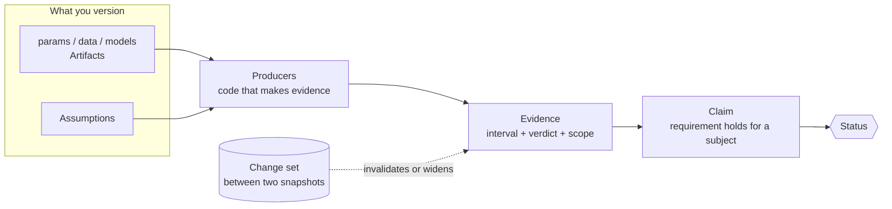
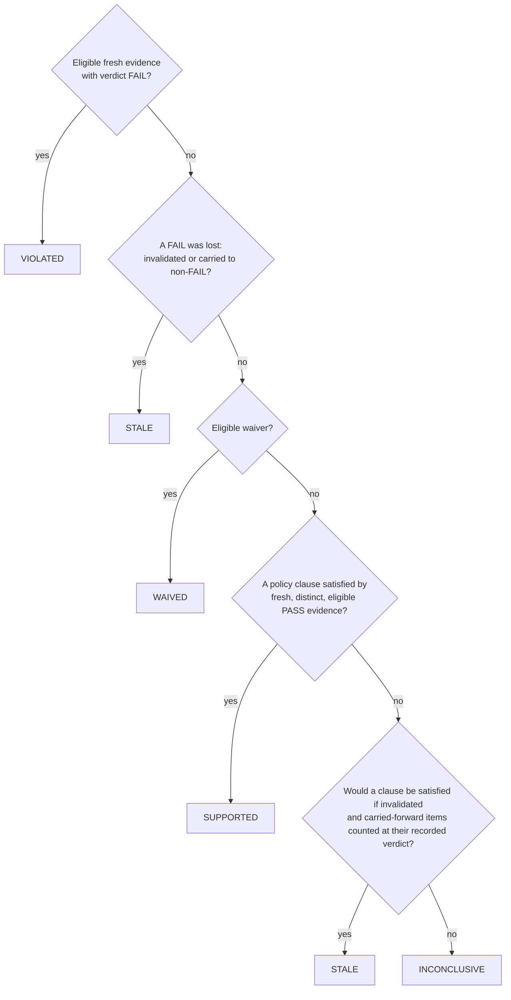

# Concepts

This page is a reading guide. The precise definitions, with all invariants and reason codes, are in the
[domain model](../03-domain-model.md) (the contract) and the [algorithms](../04-algorithms.md).

## The model in one picture



| Entity | What it is | Example |
|---|---|---|
| **Artifact** | A file whose content hash is tracked: `params`, `dataset`, `model`, `code`, `doc`. Models can be `derived_from` datasets. | `params/beam.yaml` |
| **Requirement** | A quantity, a comparison and a declared limit, with a criticality. | `tip_deflection <= 15 mm` (low) |
| **Subject** | The thing a claim is about (a duty cycle, a design). | `B1` |
| **Claim** | A requirement holding for a subject. This is what gets a status. | `C-DEFL` |
| **Producer** | A Python function registered with `@reval.producer` that computes evidence and declares exactly what it depends on. | `beam_analytic` |
| **Evidence** | An immutable record: the producer's result (point and interval, in a unit), its dependency hashes, and the scope in which it holds. | `tip_deflection = 13.39 mm` |
| **Assessment** | The status of a claim at a snapshot, with reasons. Append-only. | `C-DEFL: SUPPORTED` |

## Verdicts: from an interval to pass, fail or inconclusive

Each evidence item is reduced to a three-valued **verdict** against the requirement. For a `<=` limit *L*, pass is inclusive:
`hi <= L` passes, `lo > L` fails, an interval that straddles the limit is inconclusive. Out-of-domain ML predictions are always
inconclusive. The table of how each producer kind builds its interval is in [domain model section 2](../03-domain-model.md).

## Freshness: is this evidence still good after the change?

Evidence is recorded at a snapshot. When the snapshot changes, each evidence item gets one freshness class:

| Class | Meaning |
|---|---|
| `fresh_exact` | Every dependency hash is unchanged. |
| `fresh_out_of_scope` | Only rows outside the evidence's validity box changed (column-selector dependencies on datasets only). |
| `carry_forward` | A numeric field changed, but the producer declared a **tolerance** (a sensitivity over a valid range, backed by an assumption). The interval is widened by `kappa * sensitivity * |delta|` for this assessment. |
| `invalidated` | Anything else. Never supports a claim. |

!!! danger "Fail closed"
    An unknown change, a dependency that was not declared, a changed field with no tolerance, a change outside a tolerance's valid range,
    a changed subject or producer code, and a whole-artifact dependency on a changed artifact all produce `invalidated`.
    Declaring finer dependencies (`params#/beam/load_N` instead of `params`) is how you keep evidence fresh legitimately.

## Policies: what evidence is enough

A claim's **policy** (by criticality) is a list of clauses; a clause is a list of required evidence kinds. The defaults, shorthand:

```text
low:    [ml_prediction{in_domain}] | [physics_sim] | [measurement] | [analytic]
medium: [ml_prediction{in_domain}, physics_sim{independent_of: ml_prediction}] | [measurement] | [analytic{min_fidelity: 3}]
high:   [measurement] | [physics_sim{min_fidelity: 2}, ml_prediction{in_domain, independent_of: physics_sim}] | [analytic{min_fidelity: 3}]
```

Two items are **independent** when their producer kinds differ and their declared `predictors` are disjoint: independence is about
model form, not shared inputs. The policies are risk-informed in spirit, inspired by ASME V&V 40, and are not an implementation of it.

## Status rules

Status is **history-free**: it depends only on the current snapshot and the evidence with its freshness, never on earlier assessments.
The rules are evaluated in order and the first match wins:



<table>
<thead><tr><th>Status</th><th>Reads as</th></tr></thead>
<tbody>
<tr><td><span class="st st-ok">&#10003; SUPPORTED</span></td><td>Recorded, fresh evidence satisfies a policy clause against the declared requirement.</td></tr>
<tr><td><span class="st st-ok">&#10003; WAIVED</span></td><td>A human waiver with a justification and author is in effect. Excluded from benchmark metrics.</td></tr>
<tr><td><span class="st st-warn">&#9719; STALE</span></td><td>Support (or a refutation) was lost because of a change; re-running the right producers can restore a verdict.</td></tr>
<tr><td><span class="st st-warn">? INCONCLUSIVE</span></td><td>No evidence, out of domain, margin below uncertainty, or a missing independent source.</td></tr>
<tr><td><span class="st st-bad">&#10007; VIOLATED</span></td><td>Fresh, eligible evidence FAILs the requirement. Fail dominates.</td></tr>
</tbody>
</table>

!!! note "A change cannot launder a failure"
    If a claim was refuted and the change invalidates (or inflates away) that failing evidence, the claim becomes `STALE`, never `SUPPORTED`.
    You will see this in the [quickstart](quickstart.md): `C-S2-TEMP` goes from `VIOLATED` to `STALE`.

**Accepted** means `SUPPORTED` or `WAIVED`. The exit codes of `status`, `run` and `diff` follow from it: `0` all accepted, `1` some stale or
inconclusive, `2` some violated, `3` error.

## Reasons

Every status carries `Reason(code=...)` entries, for example `policy_satisfied`, `requirement_violated`, `evidence_invalidated`,
`no_evidence`, `out_of_domain`, `margin_below_uncertainty`, `policy_unmet`, `missing_tolerance`, `unknown_change`. The full list with the
rule that emits each one is in [domain model section 6](../03-domain-model.md). `reval explain <claim>` prints the justification tree.

## The planner

For claims that are `STALE` or `INCONCLUSIVE`, `reval plan` chooses which producers to run on which subjects. It is an integer program:
minimise total producer cost such that every restorable claim has a policy clause fully covered by fresh evidence, reusing everything already fresh.
With `--budget` it instead maximises restored criticality within the budget. `--planner greedy` gives a heuristic baseline. A claim no available
producer can restore is reported as **unrestorable**; it is never silently dropped. Details: [algorithms](../04-algorithms.md).

## What is deterministic

Snapshots hash canonical content; the status engine is a pure function of snapshot plus evidence; the planner runs with fixed seeds on a single worker.
No clock, network or language model is consulted by `reval.core`.
